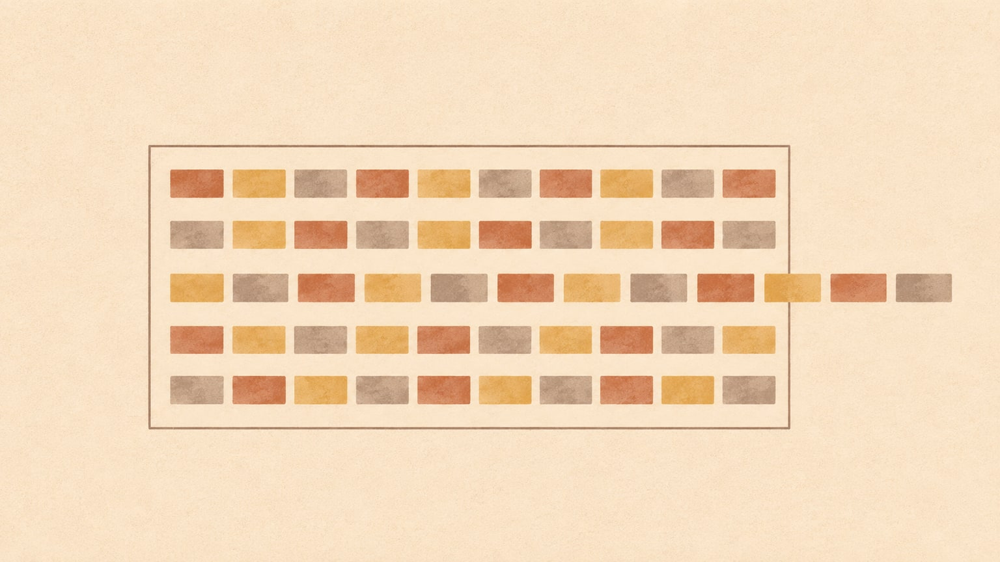

## 번호 없는 권고

2026년 11월 16일, 국가사이버안보센터(NCSC)가 Java 취약점 보안 권고를 냈다. 내용은 짧았다. OpenJDK 17.0.6 이상에서 인증 없이 원격 코드 실행이 가능하고, CVSS 4.0 기준 9.2점이라는 것. CVE 번호도, 취약한 컴포넌트도, 수정 버전도 없었다. 국정원도 공공기관에 Java 런타임 점검을 요청했다.

권고만으로는 할 수 있는 일이 많지 않았다. 운영 중인 JVM 버전을 모으고, 인터넷에 열린 서비스부터 순서를 매기고, 기반 이미지를 바로 바꿀 수 있게 준비하는 정도였다. "17.0.6 이상"이라는 표현이 21이나 25 계열도 포함하는지조차 분명하지 않았다.

다음 날인 11월 17일, 오라클이 Critical Security Patch Update를 내면서 실체가 드러났다. 번호는 CVE-2026-114938, 연구자들이 붙인 이름은 Java4Shell이다. 이 글은 그 취약점이 어떻게 생겼는지, 어떤 환경에서 실제로 위험한지, 무엇으로 막는지를 정리한다. 마지막 절에는 컨테이너 기반 이미지를 갱신하면서 직접 부딪힌 문제를 적었다.

## 무엇이 고장 났나

`java.util.Base64`의 디코더는 처음에는 평범한 Java 코드로 돈다. 호출이 잦아져 C2 컴파일러가 이 메서드를 최적화하면, 내부의 `decodeBlock()`을 x86-64용으로 손으로 짠 어셈블리 루틴(intrinsic)으로 바꿔 끼운다. CPU가 AVX-512 VBMI를 지원하면 이 루틴은 한 번에 64바이트씩 처리하는 벡터 경로를 탄다. 이 최적화는 JDK 18에 들어갔고, 2023년 1월 OpenJDK 17.0.6으로 백포트됐다. 권고의 "17.0.6 이상"은 여기서 나왔다.

문제는 64바이트 블록을 다 처리하고 남은 꼬리(tail)를 마무리하는 단계에 있다. Datadog Security Labs가 든 예시로 따라가 보면 이렇다.

1. 입력은 `A` 128개 뒤에 `=` 하나를 붙인 129자다. 디코더는 이 입력에 맞춰 98바이트짜리 출력 배열을 만든다.
2. 벡터 경로가 앞의 128자를 처리해 96바이트를 쓴다. 남은 꼬리는 `=` 한 글자다.
3. 꼬리 처리 루틴은 출력 길이를 `(꼬리 길이 / 4) * 3`으로 계산한다. 1을 4로 나누면 0이니 결과도 0이다. 그런데 패딩이 있으면 1을 빼는 분기가 있어서 값이 **-1**이 된다. 음수인지 확인하는 코드는 없다.
4. 루틴은 이 값으로 저장 마스크를 만든다. `BZHI` 명령은 지정한 위치부터 위쪽 비트를 지우는데, 위치 값으로 레지스터의 하위 1바이트만 읽는다. -1의 하위 바이트는 255다. 64보다 크니 지울 비트가 없고, 64비트 마스크가 전부 켜진 채로 남는다.
5. 전부 켜진 마스크로 64바이트를 저장한다. 98바이트 배열의 96번째 바이트부터 64바이트를 쓰니 **배열 끝 너머로 62바이트**가 넘친다. 패딩이 `==`이면 63바이트다.

넘친 자리에 쓰이는 바이트는 입력과 상관없이 대부분 `69 a6 9a`가 반복되는 고정 패턴이다. 공격자는 무엇을 쓸지는 고를 수 없고, 어디에 쓰일지만 힙 배치로 간접적으로 노릴 수 있다.

디코더는 이 입력을 잘못된 Base64로 판단해 `IllegalArgumentException`을 던진다. 하지만 예외는 쓰기가 끝난 뒤에 나온다. 애플리케이션이 예외를 잡아 400 응답을 돌려줘도 힙은 이미 오염됐다. 수정된 JVM도 같은 입력에 같은 예외를 던지기 때문에, 응답만 보고는 공격이 있었는지 구별할 수 없다. Datadog이 단독 테스트로 재현했을 때는 이웃한 배열의 헤더가 깨졌고, JVM은 한참 뒤 가비지 컬렉션 도중에 죽었다.

수정 방법은 단순하다. Endor Labs는 JDK-8393212("Base64 optimization improvements") 커밋을 수정본으로 지목한다. 꼬리 처리 진입점(`L_finalBit`)에서 남은 길이가 4보다 작으면 벡터 경로를 버리고 한 글자씩 처리하는 경로로 보낸다.

```cpp
// stubGenerator_x86_64.cpp, L_finalBit
__ cmpl(length, 4);
__ jcc(Assembler::less, L_bruteForce);
```

커밋 제목만 봐서는 보안 수정인지 알 수 없다. 2026년 10월 14일 비공개로 들어간 커밋이고, Endor Labs도 이 커밋과 CVE의 대응 관계를 "확인되지 않음"으로 표시했다. 소스에서 직접 빌드하는 경우가 아니라면 벤더가 낸 수정본을 쓰는 편이 안전하다.

## 언제 터지나

아래 조건이 모두 맞아야 취약한 경로에 들어간다.

| 조건 | 내용 |
|---|---|
| CPU | x86-64이고 AVX-512 VBMI 지원 (Intel Ice Lake 이후 서버 CPU, AMD Zen 4 이후) |
| Java 버전 | 17.0.6 이상의 17, 18 이후 전부 (21, 25, 27 포함) |
| 디코더 | `Base64.getDecoder()`, `Base64.getUrlDecoder()`. `getMimeDecoder()`는 벡터 경로를 타지 않는다 |
| JIT 상태 | C2가 디코더를 컴파일해 intrinsic으로 바꾼 뒤 |
| 입력 | `=` 또는 `==`로 끝나고 길이가 4의 배수가 아닌 Base64 |
| 입력 길이 | Java 17은 129자 이상, Java 21 이후는 65자 이상 |

입력 길이 기준이 다른 이유는 벡터 경로로 들어가는 문턱이 달라서다. Java 17은 128바이트를 넘어야, Java 21 이후는 31바이트를 넘어야 벡터 경로를 쓴다.

반대로 아래 환경은 영향이 없다.

- ARM64 (AWS Graviton, Ampere, Apple Silicon 등)
- AVX-512 VBMI가 없는 x86 (Skylake, Cascade Lake, Cooper Lake 세대 Xeon, Zen 4 이전 EPYC, Alder Lake 이후 Intel 데스크톱)
- Rosetta나 QEMU로 에뮬레이션하는 x86
- Java 8, 11, 그리고 17.0.0~17.0.5 (벡터 경로가 없다)
- `java.util.Base64`가 아니라 자체 디코더를 쓰는 라이브러리 (JJWT, Nimbus JOSE+JWT, Jackson, Apache Commons Codec)

## 왜 인증 전에 터지나

Base64 디코딩은 대개 인증보다 먼저 일어난다. 디코딩을 해야 자격 증명을 꺼낼 수 있기 때문이다. Equixly가 꼽은 경로는 이렇다.

- **HTTP Basic 인증**: `Authorization: Basic ...` 헤더를 디코딩한 뒤에야 비밀번호를 비교한다. Spring Security는 여기에 `java.util.Base64`를 쓴다.
- **JWT**: 헤더와 페이로드를 Base64URL로 디코딩한다. 라이브러리에 따라 서명 검증보다 디코딩이 먼저다. Auth0 java-jwt가 `java.util.Base64`를 쓴다.
- **SAML 메시지, 웹훅, 요청 본문의 Base64 필드**: 코드가 `java.util.Base64`를 직접 부를 때.

로그인 화면이 없는 API 서버라도 `Authorization` 헤더를 받기만 하면 공격 표면이 된다. 내부망 서비스도 다른 서버를 거쳐 닿을 수 있으니 범위에서 빼기 어렵다.

## 실제로 얼마나 위험한가

점수부터 엇갈린다. 취약점을 공개한 Calif는 CVSS 4.0으로 9.2점을 매겼다. 오라클과 Amazon Corretto는 CVSS 3.1로 8.1점을 매겼다. 9.2는 최악의 경우를 가정한 점수이고, 실제 노출은 Java 버전과 CPU와 애플리케이션 구조에 따라 달라진다.

현실적인 결과는 서비스 거부다. 넘친 바이트 대부분은 빈 메모리에 떨어지지만, 살아 있는 객체의 헤더를 덮으면 JVM이 죽는다. 요청 몇 번으로 인증 없이 서버를 내릴 수 있다면 그것만으로도 급하다.

원격 코드 실행은 별개의 문제다. Calif는 다섯 단계짜리 연쇄 공격을 설명한다.

1. 배열 하나의 길이 필드를 덮어 애플리케이션 자신의 쓰기가 범위를 넘게 만든다.
2. 응답에 담겨 나가는 다른 배열을 오염시켜 힙 메모리를 빼낸다.
3. 망가진 객체 헤더를 고쳐 JVM이 계속 돌게 한다.
4. 원격에서 힙 배치를 조정해 넘치는 자리에 원하는 객체가 오게 한다.
5. JVM의 Code Cache에 쓰기를 유도한다.

Calif 스스로도 "범용 익스플로잇은 없다"고 말한다. 대상마다 디코더에 닿는 경로, 쓸 수 있는 버퍼, 결과를 돌려받을 통로, 힙 배치를 따로 찾아야 한다. Calif는 Keycloak, Jira, Confluence, Artifactory, Jenkins, PingFederate의 기본 설정에서 인증 없이 코드 실행이 가능하다고 주장했지만 공격 코드는 공개하지 않았다. Equixly는 넘치는 바이트를 공격자가 고를 수 없다는 점을 들어 이 주장이 아직 입증되지 않았다고 본다. 11월 17일 기준으로 실제 공격 사례는 보고되지 않았고 CISA KEV에도 오르지 않았다.

인증 없는 서비스 거부는 확실하다. 코드 실행은 가능성이 있지만 앱마다 공격을 따로 만들어야 한다. 어느 쪽이든 패치를 미룰 이유는 되지 않는다.

## 내 환경이 해당하는지 확인하기

**CPU**부터 본다. 결과가 비어 있으면 취약한 경로에 들어가지 않는다.

```bash
grep -o -w -m1 avx512vbmi /proc/cpuinfo
```

**JVM 플래그**로 벡터 경로가 켜져 있는지 본다. `UseAVX`가 2보다 크고 `UseBASE64Intrinsics`가 `true`면 경로가 살아 있다.

```bash
java -XX:+PrintFlagsFinal -version | grep -E ' (UseAVX|UseBASE64Intrinsics) '
```

**실제로 도는 JVM**을 확인한다. 셸에서 `java -version`을 치면 PATH에 걸린 Java만 보인다. 애플리케이션이 다른 JDK를 번들로 들고 있거나, 한 컨테이너 안에 JVM이 여럿일 수 있다. 실행 중인 프로세스를 직접 본다.

```bash
ps -eo pid,args | grep '[j]ava'
readlink -f /proc/<PID>/exe
jcmd <PID> VM.version
jcmd <PID> VM.flags -all | grep -E 'UseAVX|UseBASE64Intrinsics'
```

`jcmd`는 대상 프로세스와 같은 사용자로 실행해야 붙는다.

관리형 컨테이너 환경에서는 CPU 세대를 고르기 어렵다는 점도 기억해야 한다. AWS Fargate는 x86 태스크에 어떤 세대의 CPU가 배정될지 보장하지 않는다. 오늘 확인한 태스크가 VBMI 없는 CPU에서 돌았더라도 다음 배포에서는 달라질 수 있으니, x86에서 돌린다면 노출된 것으로 보고 대응하는 편이 맞다. ARM64로 돌리는 서비스라면 이번 취약점에서는 빠진다.

## 수정 버전

11월 17일에 나온 수정본은 아래와 같다. Oracle 행은 Datadog이 정리한 표를 따랐다. 출처에 따라 Oracle의 25, 27 빌드 공개 여부가 엇갈리니 Oracle 공지에서 한 번 더 확인하는 편이 좋다.

| 배포판 | Java 17 | Java 21 | Java 25 | Java 27 |
|---|---|---|---|---|
| Oracle Java SE | 17.0.21.1 | 21.0.13.1 | 25.0.5.1 | 27.0.1.1 |
| OpenJDK | | | | 27.0.1.1 (`jdk-27.0.1.1-ga`) |
| Amazon Corretto | 17.0.21.1.2 | | 25.0.5.1.2 | |

Corretto 25.0.5.1.2와 17.0.21.1.2는 CHANGELOG의 CVE 표 첫 줄에 CVE-2026-114938(8.1, hotspot/compiler)을 올렸다. 함께 고친 CVE는 25 계열이 10건, 17 계열이 8건이다. TLS와 JGSS 쪽 7점대 취약점도 들어 있다. Temurin, Zulu, Microsoft, Red Hat 빌드는 벤더마다 일정과 버전 표기가 다르니 각자의 공지를 확인해야 한다.

버전 번호의 네 번째 자리를 눈여겨볼 만하다. Java 버전 체계(JEP 322)에서 `$FEATURE.$INTERIM.$UPDATE.$PATCH` 중 마지막 `PATCH`는 정기 업데이트 사이에 내는 긴급 수정에만 쓴다. `25.0.5.1`의 마지막 `.1`은 10월 정기 업데이트 25.0.5 위에 얹은 첫 긴급 수정이라는 뜻이다. Corretto는 그 뒤에 자체 빌드 번호를 하나 더 붙인다.

여기서 주의할 점이 있다. 버전 숫자가 "수정됨" 열과 같아도, 그 빌드에 수정 코드가 실제로 들어갔는지는 별개다. 벤더 CHANGELOG에서 CVE 번호를 직접 확인하는 습관이 필요하다.

## 패치 전까지 막는 법

이미지를 다시 굽고 배포하는 데 하루 이상 걸린다면, JVM 옵션으로 취약한 경로를 꺼 둘 수 있다. 범위가 좁은 것부터 나열하면 이렇다.

```bash
# 1. Base64 디코드 intrinsic 하나만 끈다
-XX:+UnlockDiagnosticVMOptions -XX:DisableIntrinsic=_base64_decodeBlock

# 2. Base64 인코드와 디코드 intrinsic을 모두 끈다
-XX:-UseBASE64Intrinsics

# 3. AVX-512 전체를 끄고 AVX2까지만 쓴다
-XX:UseAVX=2
```

1번과 2번은 Base64 처리 속도만 조금 손해 본다. 3번은 암호화를 비롯한 다른 벡터 연산까지 느려지니 앞의 두 옵션을 쓸 수 없을 때만 고른다. 3번에는 함정이 하나 더 있다. ARM64 JVM은 `UseAVX`를 알지 못해 기동에 실패한다. x86과 ARM 태스크가 섞인 환경에서 공통 `JAVA_TOOL_OPTIONS`에 넣으면 멀쩡하던 ARM 서비스가 죽는다.

이 옵션들은 어느 벤더도 이 CVE의 공식 완화책으로 확인하지 않았다. 적용한 뒤에는 `jcmd <PID> VM.flags -all`로 실제 값이 바뀌었는지 확인하고, 패치를 마치면 옵션을 걷어낸다.

입구에서 막는 방법도 있다. Equixly가 제시한 WAF 규칙은 길이가 4의 배수가 아니면서 패딩으로 끝나는 Basic 인증 값을 거른다.

```text
^Basic\s+(?:\S{4})*\S{0,2}=$
```

JWT는 원래 패딩을 쓰지 않으니(RFC 7515) `=`가 들어간 JWT도 거절해도 된다. 다만 Base64가 요청 본문이나 다른 헤더에 실려 오는 경로까지 WAF로 다 덮기는 어렵다. 어디까지나 패치 전까지 시간을 버는 수단이다.

탐지 신호로는 한 출처에서 몰려오는 `java.util.Base64`의 `IllegalArgumentException`, 그리고 GC 복사 루틴에서 SIGSEGV가 나고 스택에 `Base64$Decoder.decode0`이 찍힌 `hs_err_pid*.log`가 있다. 크래시 로그에 Base64가 안 보일 수도 있으니, 평소에 없던 JVM 크래시가 반복되면 이 취약점을 의심해 볼 만하다.

## 컨테이너 이미지로 패치할 때 걸리는 것들

수정 버전을 찾는 것보다 그 버전을 실제 이미지에 넣는 일이 더 까다로웠다. Corretto 25와 17로 기반 이미지를 갱신하면서 걸린 지점을 적어 둔다.

### 공식 이미지 태그는 패키지 저장소보다 늦다

11월 17일 확인했을 때 Docker Hub의 `amazoncorretto:25-alpine` 태그는 11월 5일 빌드 그대로였다. 아직 수정본이 아니었다. 반면 Corretto의 Alpine 패키지 저장소(`apk.corretto.aws`)에는 `amazon-corretto-25=25.0.5.1.2-r0`가 이미 올라와 있었다. 공식 이미지를 기다리지 않고, 기존 이미지 위에서 JDK 패키지만 버전을 지정해 올리면 당일에 수정본을 넣을 수 있다.

```dockerfile
FROM amazoncorretto:25-alpine@sha256:<기존 digest>
RUN apk add --no-cache --upgrade amazon-corretto-25=25.0.5.1.2-r0
RUN java -version 2>&1 | grep -q '"25.0.5.1"'
```

Amazon Linux 2023 기반 이미지는 사정이 조금 다르다. AL2023은 날짜별 저장소 스냅샷(releasever)을 고정해 쓰는데, `2023.12.20261116` 스냅샷에는 25.0.5.0.10까지만 있었고 `2023.12.20261117`부터 25.0.5.1.2와 17.0.21.1.2가 함께 들어왔다. 스냅샷 값을 올리면 JDK도 같이 올라간다.

```bash
dnf -y --releasever=2023.12.20261117 upgrade \
  java-25-amazon-corretto-headless java-17-amazon-corretto-headless
```

마지막 줄의 `java -version` 검사는 빼지 않는 편이 좋다. 패키지 고정 값과 원본 이미지가 어긋나면 의도와 다른 JDK가 들어가는데, 빌드가 실패해야 그 사실을 바로 안다.

### 고정한 이미지는 정기 패치도 지나친다

재현 가능한 빌드를 위해 기반 이미지를 digest로, 패키지를 버전으로 고정해 두었다. 같은 커밋은 언제 빌드해도 같은 결과가 나온다. 이번에 그 대가를 확인했다. 이미지 안의 JDK는 25.0.4.1이었다. 10월 정기 업데이트(25.0.5.0.9, 25.0.5.0.10)도 들어가지 않은 상태였고, 거기에는 CVE-2026-114820(9.1, java.security)이 포함돼 있었다.

Java4Shell을 막으려고 올린 25.0.5.1.2는 누적 수정본이라 10월 취약점도 같이 해결됐다. 운이 좋았던 셈이다. 고정은 "바뀌지 않음"을 보장할 뿐 "최신임"을 보장하지 않는다. 고정 값을 언제 올릴지 정해 두지 않으면 이미지는 조용히 낡아 간다. 분기마다 오는 정기 업데이트에 맞춰 고정 값을 올리는 일정을 따로 잡아 두는 것이 좋다.

### 고정한 패키지가 저장소에서 사라진다

JDK만 올리고 다시 빌드했더니 Alpine 이미지 하나가 실패했다.

```text
ERROR: unable to select packages:
    breaks: world[zlib=1.3.2-r1]
```

이전 보안 대응 때 `zlib=1.3.2-r1`로 고정해 둔 패키지가 저장소에서 빠지고 `1.4-r0`만 남아 있었다. Alpine 저장소는 패키지마다 최신 리비전만 남긴다. 그래서 버전을 고정한 Dockerfile은 시간이 지나면 같은 커밋으로도 빌드되지 않는다. 긴급 패치 중에 이런 실패를 만나면 당황하기 쉬우니, 고정한 패키지 목록과 현재 저장소 버전(`apk search -x <패키지>`)을 함께 확인하고 시작하면 좋다.

### 이미지 안의 JVM을 전부 찾는다

애플리케이션은 Java 25로 도는데, 같은 이미지에 Java 17이 하나 더 들어 있었다. 외부 라이브러리가 자식 프로세스로 띄우는 JVM이었다. 애플리케이션 JVM만 올렸다면 17은 그대로 취약하게 남았을 것이다. 기반 이미지를 갱신할 때는 `/usr/lib/jvm` 아래와 패키지 목록(`rpm -qa | grep corretto`, `apk info -v | grep corretto`)을 보고 JVM을 모두 찾아야 한다.

### 배포가 끝나야 끝난다

기반 이미지를 새로 게시해도, 그 이미지로 앱을 다시 빌드하고 배포하고 재시작하기 전까지 실행 중인 JVM은 그대로다. 파일을 바꿔도 이미 떠 있는 프로세스의 코드는 바뀌지 않는다. 마지막에는 실행 중인 태스크의 이미지 digest와 `jcmd <PID> VM.version` 결과를 대조해 기록해야 대응을 마쳤다고 할 수 있다.

## 대응 체크리스트

대응 순서를 체크리스트로 남긴다.

1. **범위 파악**: 실행 중인 JVM의 버전과 CPU의 `avx512vbmi` 지원 여부를 모은다. 인터넷에 열린 서비스부터 순서를 매긴다.
2. **임시 완화**: 패치까지 시간이 걸리면 `-XX:-UseBASE64Intrinsics` 같은 옵션을 x86 서비스에 넣고 `jcmd`로 확인한다.
3. **패치**: 벤더 수정본(Corretto 25.0.5.1.2, 17.0.21.1.2 등)의 CHANGELOG에서 CVE 번호를 확인한 뒤 기반 이미지를 갱신한다. 이미지 안의 JVM을 전부 올린다.
4. **확인**: 재배포와 재시작 후 실행 중인 프로세스의 JVM 버전을 대조한다. 임시 완화 옵션을 걷어낸다.
5. **다음을 위해**: 고정해 둔 이미지와 패키지 버전을 정기 업데이트마다 올리는 일정을 만든다.

권고가 나온 날에는 번호도 수정본도 없었다. 그 하루 동안 할 수 있었던 일은 범위를 파악하고 교체 경로를 점검하는 것뿐이었다. 수정본은 다음 날 나왔고, 남은 일은 그 경로를 따라가는 것이었다. 취약점이 공개되기 전에 해 둘 수 있는 준비가 생각보다 많다.

## 참고 자료

- [Datadog Security Labs, Java4Shell: Remote Code Execution in OpenJDK (CVE-2026-114938)](https://securitylabs.datadoghq.com/articles/java4shell-remote-code-execution-in-openjdk-cve-2026-114938/)
- [Equixly, CVE-2026-114938: pre-auth heap overflow in Java 17, 21 and 25](https://equixly.com/blog/2026/11/17/cve-2026-114938-pre-auth-heap-overflow-in-java-17-21-and-25/)
- [Endor Labs, Java4Shell: Unauthenticated RCE reported in OpenJDK 17](https://www.endorlabs.com/learn/java4shell-unauthenticated-rce-reported-in-openjdk-17-cve-2026-114938)
- [Amazon Corretto 25 CHANGELOG](https://github.com/corretto/corretto-25/blob/develop/CHANGELOG.md)
- [Amazon Corretto 17 CHANGELOG](https://github.com/corretto/corretto-17/blob/develop/CHANGELOG.md)
- [서울경제, PHP 이어 '자바'서도 보안 결함](https://www.sedaily.com/article/20115665)
