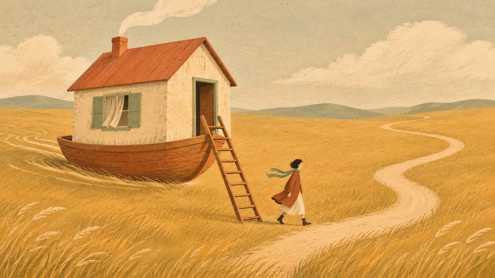

## 다섯 칸짜리 사다리

어릴 때부터 들어 온 사다리가 하나 있다. 좋은 대학에 들어가고, 대기업에 입사하고, 자격증을 하나쯤 따 두고, 집을 사고, 그 집에서 쭉 살다가 은퇴한다. 모두 다섯 칸이다. 칸마다 할 일이 정해져 있고 순서도 정해져 있다. 마지막 칸에 오르면 더 오를 필요가 없다. 그 자리에 머물면 된다는 약속이 사다리 꼭대기에 붙어 있었다.

이 사다리를 성실하게 오른 사람을 꽤 많이 안다. 이상한 건 그들이 요즘 가장 불안해한다는 점이다. 칸을 빼먹은 적이 없는데, 오히려 빼먹은 적이 없어서 불안하다. 남들이 밟은 칸을 남들처럼 밟아 왔으니 자기만 가진 게 무엇인지 말하기 어렵다. 회사 밖에서 자기를 소개하려 하면 회사 이름 말고는 문장이 잘 떠오르지 않는다.

채용 자리에서도 비슷한 감각을 느낀다. 이력서를 넘기다 보면 문서들이 점점 서로를 닮아 간다. 같은 순서의 학력, 같은 종류의 자격, 같은 문장으로 시작하는 자기소개. 모두 성실하게 쓴 문서인데, 성실함만으로는 서로 구별되지 않는다. 사다리를 잘 오른 사람일수록 그 사다리 위에서 서로 겹쳐 보인다.

## 사다리는 원래 잘 작동했다

이 사다리를 비웃고 싶지는 않다. 꽤 오랫동안 이것은 실제로 잘 작동하는 길이었다. 학교 이름은 그 사람이 무엇을 얼마나 아는지 보증했다. 회사는 한 번 들어가면 정년까지 책임져 주었다. 자격증은 한 번 따 두면 평생 밥벌이를 지켰고, 집은 사 두기만 하면 가장 안전한 저축이 되었다. 칸마다 믿을 만한 보증인이 서 있었던 셈이다.

부모 세대가 자식에게 이 길을 권하는 것도 그래서 이해가 된다. 그들은 이 사다리로 실제 삶을 꾸렸다. 직접 올라 보고 효과를 본 길을 자식에게 권하는 건 사랑에 가깝다. 문제는 사다리가 아니라 사다리를 떠받치고 있던 바닥에 있다.

다섯 칸에는 공통된 전제가 하나 깔려 있다. 세상이 충분히 오래 가만히 있어 준다는 것. 스무 살에 고른 전공이 마흔 살에도 쓸모 있고, 서른 살에 들어간 회사가 예순 살에도 남아 있고, 한 번 익힌 기술이 은퇴할 때까지 값을 하고, 한 번 고른 동네가 평생 살 만한 곳으로 남는다는 믿음이다. 한 번 고르면 끝나는 선택들. 이 사다리는 그런 선택이 가능하던 시기에 세워졌고, 돌아보면 그 시기는 생각보다 짧고 예외적이었다.

## 세상이 가만히 있지 않을 때

바닥이 움직이기 시작하면 칸마다 금이 간다.

학교 이름이 보증하던 것은 대개 "이 사람은 이만큼 안다"였다. 그런데 아는 것의 값이 빠르게 내려가고 있다. 웬만한 지식은 질문 한 줄이면 기계가 더 빠르고 싸게 내놓는다. 아는 것을 보증하던 증서는 그 지식이 귀할 때만 귀했다.

회사는 이제 사람보다 짧게 산다. 한 회사에 평생을 맡긴다는 건 그 회사가 내 커리어보다 오래 살아남는다는 데 거는 일인데, 그 내기는 점점 불리해진다. 자격증도 비슷하다. 자격증이 지켜 주던 일은 절차가 정해진 일이고, 절차가 정해진 일일수록 먼저 자동화된다. 집도 다르지 않다. 집 한 채를 사서 평생 그 자리에 머무는 일은 삶의 대부분을 카드 한 장에 거는 일이기도 하다. 그 카드가 좋은 카드일 수도 있다. 다만 손에 쥔 카드가 한 장뿐이라는 사실은 그대로 남는다.

칸 간격이 일정한 사다리는 누구나 오를 수 있다. 그게 사다리의 장점이었다. 정해진 순서로 정해진 동작을 반복하면 정해진 높이에 닿는다. 예전에는 같은 사다리를 오르는 상대가 옆자리 사람뿐이었다. 지금은 지치지도 않고 잠도 자지 않는 기계가 같은 사다리에 붙었다. 정답을 빨리 맞히고 정해진 형식을 정확히 지키는 동작, 우리가 가장 열심히 연습해 온 그 동작이 기계가 가장 잘하는 동작이다.

더 무서운 건 모두가 같은 사다리에 매달려 있다는 점이다. 같은 학원, 같은 시험, 같은 회사, 같은 동네의 같은 평수. 사다리 하나에 너무 많은 사람이 매달려 있으면 그 사다리가 흔들릴 때 다 같이 떨어진다. 안전해 보였던 건 사다리가 튼튼해서가 아니라 다들 거기 있어서였다.

## 아이들이 어른이 될 무렵

지금 어른들은 그나마 사다리가 서 있는 걸 보며 자랐다. 흔들리기 시작한 건 오르는 도중이었고, 몇 칸은 약속대로 밟아 보기도 했다. 지금 아이들은 사정이 다르다. 오늘 초등학생인 아이가 어른이 되는 건 십수 년 뒤다. 지금도 이만큼 흔들리는 사다리가 그때까지 서 있을지, 서 있다면 몇 칸이나 남아 있을지 아무도 장담하지 못한다.

그런데도 불안한 어른들은 아이를 같은 사다리 앞에 세운다. 더 이른 나이에, 더 촘촘한 학원 시간표로 칸을 미리 밟아 두게 한다. 부모 세대가 우리에게 사다리를 권하던 때를 떠올리면 이 마음도 이해가 된다. 자기가 아는 가장 안전한 길을 건네는 건 여전히 사랑이다. 다만 그때와 다른 점이 하나 있다. 그들은 사다리가 작동하는 걸 직접 확인하고 권했지만, 우리는 사다리가 흔들리는 걸 보면서도 같은 사다리를 물려주고 있다.

아이가 스무 살이 됐을 때 어떤 칸이 쓸모 있을지 지금 정확히 아는 어른은 없다. 어떤 직업이 남고 어떤 자격이 값을 할지, 그 답을 쥔 사람이 없다. 정답을 모르는 어른이 정답 맞히는 법만 열심히 가르치는 셈이다. 아이들은 우리가 출제할 수 없는 시험을 치르며 어른이 된다.

그렇다면 물려줄 것은 사다리가 아니라 맨땅을 걷는 법이다. 남이 낸 문제를 푸는 대신 스스로 질문을 내 보는 경험, 정답지 없이 무언가를 끝까지 해 보는 시간, 틀린 길에 들어섰다가 돌아 나와 다시 고르는 연습. 이런 것들은 학원 시간표의 칸에 들어가지 않는다. 그래서 어른이 일부러 비워 두지 않으면 남지 않는다.

## 사다리 바깥에서 자라는 것들

그러면 무엇이 남는가. 칸으로 나눌 수 없는 것들이 남는다.

개발을 오래 하면서 자주 본 장면이 있다. 오래 기억에 남는 해법은 그 분야를 가장 깊게 판 사람보다 엉뚱한 길을 지나온 사람에게서 나올 때가 많았다. 다른 일을 하다 온 사람은 모두가 당연하게 넘기던 전제를 먼저 의심했다. 서로 상관없어 보이는 경험이 한 사람 안에서 섞이면 다른 누구에게도 없는 조합이 생긴다. 그 조합은 사다리 위에 없다.

사다리는 효율을 위해 곁가지를 잘라 내도록 설계되어 있다. 전공 하나를 고르면 나머지를 접고, 직무 하나를 고르면 나머지 관심은 취미로 미룬다. 군더더기 없이 깔끔해질수록 칸을 빨리 오른다. 그런데 잘라 낸 곁가지가 실은 다음 생각이 자라는 거름이었다.

아무도 시키지 않았는데 붙잡고 있는 질문도 남는다. 시험에는 출제자가 있고, 출제자가 있는 문제는 언젠가 기계가 푼다. 출제자가 없는 질문, 내가 궁금해서 내가 낸 문제는 남이 대신 풀어 주지 못한다. 그 질문을 품고 있는 사람이 나 하나뿐이기 때문이다.

그리고 계속 고쳐 고르는 능력이 남는다. 사다리의 선택은 한 번 하면 끝나는 선택이었다. 이제는 고른 것을 다시 고르는 일이 일상이 된다. 전공을 다시 고르고, 일하는 방식을 다시 고르고, 사는 곳을 다시 고른다. 한 번의 정답보다 여러 번의 수정을 견디는 힘이 더 중요해진다.

## 머무는 삶에서 움직이는 삶으로

사다리를 걷어차자는 말을 하려는 게 아니다. 대학도 회사도 자격증도 집도 여전히 쓸모 있다. 달라진 건 사다리 끝에 정착지가 있다는 약속이다. 다섯 칸을 다 올라도 그 자리에서 평생 머물 수 있다는 보장은 이제 없다.

그래서 "그 집에서 쭉 산다"는 그림 대신 다른 그림을 붙잡아 보려 한다. 짐을 가볍게 꾸리고, 필요하면 옮겨 갈 수 있는 삶. 한 곳에 깊이 뿌리내리는 대신 어디로 옮겨 가도 다시 뿌리내릴 줄 아는 삶. 머무는 능력보다 움직이는 능력이 안정을 만드는 쪽으로 세상이 기울고 있다.

요즘 스스로에게 자주 던지는 질문이 몇 개 있다.

- 지금 내 선택은 모범답안인가, 내 답인가
- 내가 가진 능력과 자산 가운데 하나가 무너져도 버틸 만큼 섞여 있는가
- 내 경험 중에 남과 겹치지 않는 조합은 무엇인가
- 최근에 아무도 시키지 않은 일을 해 본 적이 있는가
- 아이에게 물려주려는 것은 사다리인가, 걷는 법인가

오해가 없었으면 하는 선이 하나 있다. 사다리에서 내려온다는 건 아무것도 하지 않는다는 뜻이 아니다. 정답지 없이 무언가를 한다는 뜻이다. 아무것도 하지 않는 사람은 사다리 위에 있든 아래에 있든 같은 자리에 머문다. 정답지 없이 움직이는 사람만 맨땅에 길을 낸다.

사다리가 끝나는 자리에는 바닥이 있다. 칸도 순서도 없는 맨땅이다. 거기서 어느 쪽으로 걸을지는 이제 각자 정해야 한다. 마지막으로 정답지 없이 한 걸음을 디뎌 본 건 언제였을까.
